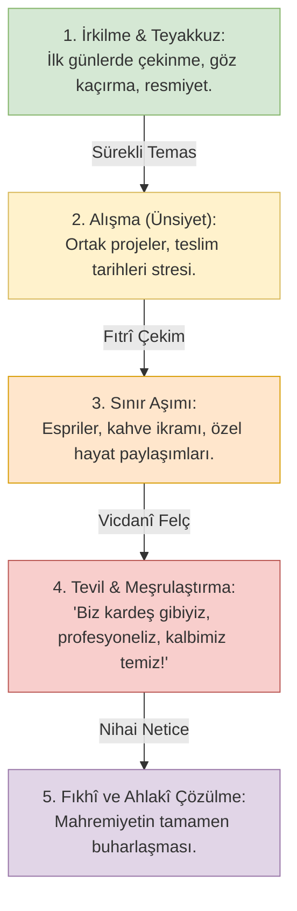

# 01. Tesettür, Gadd-ı Basar ve İhtilat: Kumaştan Sosyal Mesafeye

> *"Mümin erkeklere söyle, gözlerini haramdan sakınsınlar ve ırzlarını korusunlar. Bu onlar için daha temizdir... Mümin kadınlara da söyle, gözlerini haramdan sakınsınlar ve ırzlarını korusunlar; (kendiliğinden) görünen kısımlar müstesna, ziynetlerini göstermesinler ve başörtülerini yakalarının üzerine salsınlar..."*  
> **(en-Nûr Sûresi, 30-31)**

---

## 1. Kavramsal Giriş: Tesettür Bir Üniforma Değil, Bir Yaşam Rejimidir

Modern seküler algı, İslam'ın kutsal emirlerini daima kendi materyalist ve pragmatist lügatine tercüme ederek ehlileştirmeyi hedefler. Bu sinsi tahrifatın en ağır faturası şüphesiz **tesettür** mefhumuna kesilmiştir. Çağdaş toplumda tesettür; kadının saç telini ve vücudunun belirli kısımlarını örten, rengi, deseni ve modası küresel kapitalist tekstil endüstrisi tarafından belirlenen bir "kıyafet tarzına" indirgenmiştir.

Oysa Kur'ân-ı Kerîm'in lafzı, Sünnet-i Seniyye'nin amelî tatbikatı ve 14 asırlık fıkıh müktesebatı incelendiğinde; tesettürün yalnızca kumaştan ibaret olmadığı, **mekânsal, işitsel, görsel, zihinsel ve davranışsal katmanları olan tavizsiz bir "mahremiyet ekosistemi"** olduğu görülür.

Geleneksel fıkhın tesettür mimarisi şu üç ayrılmaz sacayağı üzerine kuruludur:

```text
                           ┌────────────────────────────────────────┐
                           │      İSLÂMÎ TESETTÜR EKOSİSTEMİ        │
                           └──────────────────┬─────────────────────┘
                 ┌────────────────────────────┼────────────────────────────┐
                 ▼                            ▼                            ▼
      ┌─────────────────────┐      ┌─────────────────────┐      ┌─────────────────────┐
      │   1. SETR-İ AVRET   │      │   2. GADD-I BASAR   │      │   3. SEDD-İ ZERÂİ   │
      │  (Maddî Örtünme)    │      │   (Göz Disiplini)   │      │  (İhtilat Yasağı)   │
      │                     │      │                     │      │                     │
      │ Bedenin haram olan  │      │ Karşı cinse şehvet, │      │ Kadın ve erkeğin    │
      │ hatlarını şeffaf ve │      │ merak ve ünsiyetle  │      │ meşru zaruret       │
      │ dar olmayacak tarzda│      │ bakmaktan iradî     │      │ olmaksızın bir arada│
      │ gizlemek.           │      │ olarak kaçınmak.    │      │ karışmasını engelleme│
      └─────────────────────┘      └─────────────────────┘      └─────────────────────┘
```

Modern karma eğitim amfilerinde, teknoloji Ar-Ge laboratuvarlarında ve açık ofisli plazalarda bu üç ilkeden ikisi (Gadd-ı Basar ve İhtilat Yasağı) tamamen tasfiye edilmiş; geriye sadece kafaya dolanan sembolik bir kumaş parçası bırakılmıştır. Bu durum, tesettürün koruyucu zırhını buharlaştırmış, onu seküler bir yapay ortamda mevcudiyet göstermek için takılan sembolik bir "kültürel etikete" indirgemiştir.

---

## 2. İlahi Emir Sıralaması ve Tefsir Geleneği: Önce Gadd-ı Basar, Sonra Örtü

Nûr Sûresi'nin 30 ve 31. âyetlerindeki ilahî tertip ve nüzul mantığı fevkalade manidardır: Cenâb-ı Hak, kadının başörtüsünü yakasının üzerine salmasını emretmeden evvel, **hem erkeğe hem de kadına gözlerini sakınmayı (gadd-ı basar)** emretmiştir.

### Klasik Tefsir Âlimlerinin Tahlilleri:

#### İbn Kesîr (v. 774/1373) *Tefsîru'l-Kur'âni'l-Azîm*:
> *"Bu âyet-i kerîme, Allah Teâlâ'nın mümin kullarına, kendilerine helal kılmadığı şeylere bakmayı haram kılan kesin bir fermanıdır. Göz, kalbe açılan en büyük kapıdır. Bakışını serbest bırakan kimse, helak vadilerine yuvarlanır. Zira Cenâb-ı Hak, ırzın korunmasını (hıfzu'l-ferc) doğrudan gözün sakınılmasına (gadd-ı basar) bağlamıştır. Çünkü kişi bakmadıkça kalbinde şehvet ve meyil alevlenmez; baktığı anda ise tohum ekilmiş olur."*

#### Ebû Bekr el-Cessâs (v. 370/981) *Ahkâmü'l-Kur'ân*:
> *"Âyette geçen 'Gözlerini sakınsınlar' emri mutlak bir nehidir. Erkek için yabancı kadına bakmak haram olduğu gibi; kadının da yabancı erkeğe bakması aynı şekilde haramdır. Zira fitne ve şehvet iki taraflıdır. 'Bu onlar için daha temizdir' (Zâlike ezkâ lehüm) buyruğu, gözü sakınmanın kalbi nifaktan, fısktan ve günah kirinden arındıracak yegâne iksir olduğunu gösterir. Gözünü sakınmayan bir toplumda kalplerin temiz kalacağını iddia etmek, ateşe odun atıp duman çıkmamasını beklemeye benzer."*

#### İmam Kurtubî (v. 671/1273) *el-Câmi' li-Ahkâmi'l-Kur'ân*:
> *"Göz, bedenin casusudur; hayrı da şerri de kalbe o taşır. Âyette 'min ebsârihim' denilerek 'min' harf-i cerri teb'îz (bazılık) için getirilmiştir. Çünkü insanın yolda yürürken veya zarurî bir muamele esnasında gayriihtiyarî olarak bir şeye gözünün ilişmesi kaçınılmazdır. Şeriat, ilk ansızın bakışı affetmiş (fec'eten); fakat ikinci ve dikkatli bakışı, nazar-ı dikkati sürdürmeyi kesinlikle yasaklamıştır."*

---

## 3. İbnü'l-Kayyim el-Cevziyye: "Bakış Kalbe Atılan Zehirli Bir Oktur"

İslam düşüncesinde şehvet psikolojisini ve kalbin afetlerini en derinlemesine inceleyen allâme **İbnü'l-Kayyim el-Cevziyye (v. 751/1350)**, *el-Cevâbü'l-Kâfî li-men Seele ani'd-Devâi'ş-Şâfî* ve *Ravzatü'l-Muhibbîn* adlı şaheserlerinde bakışın anatomisini şöyle teşrih eder:

> *"Bakış, şeytanın yayından fırlatılmış zehirli bir oktur. Kim Allah korkusuyla gözünü haramdan sakınırsa, Allah onun kalbine kıyamet gününe kadar tadacağı bir imân halâveti bahşeder.*  
> *Bilinmelidir ki, bütün fitnelerin ve günahların başlangıcı 'bakış'tır (nazar). Süreç şöyle işler:*  
> 1. *Önce **Bakış (en-Nazar)** gerçekleşir.*  
> 2. *Bakış, zihinde bir **Hâtıra (el-Hâtır - Düşünce/İmge)** doğurur.*  
> 3. *Hâtıra sürekli beslenerek **Fikir (el-Fikr)** haline gelir.*  
> 4. *Fikir kalpte yerleşerek **Şehvet (eş-Şehveh)** kıvılcımını tutuşturur.*  
> 5. *Şehvet büyüyerek **İrâde (el-İrâdeh)** halini alır.*  
> 6. *İrâde kuvvetlenerek **Azim (el-Azîme)** derecesine ulaşır.*  
> 7. *Azim ise kaçınılmaz olarak **Fiil (el-Fi'l - Günah ve İhlal)** ile neticelenir.*  
> 
> *İşte bu sebeple göz kapaklarını indirmek, sonradan önü alınamayacak bu devasa yangını baştan söndürmektir. Yangın bir kıvılcımla başlar; akıllı kimse kıvılcımı söndürür, ahmak ise kıvılcımı seyre dalıp evinin yanışını izler."*

### Karma Çalışma Ortamında Bu Tahlilin İzdüşümü:
Günde 8-10 saat boyunca aynı açık ofis masasında karşılıklı oturan, aynı monitöre doğru eğilen, toplantı masasında yan yana oturan bir kadın ile bir erkeğin İbnü'l-Kayyim'in tarif ettiği bu psiko-fıtrî süreçten muaf kalacağını iddia etmek ahmaklıktır. 
Gözün sürekli karşı cinsin siluetine, saçına, yüzüne, mimiklerine ve hareketlerine maruz kaldığı bir mekânda *gadd-ı basar* yapılamaz. Yapılamayan emir zayi olur; zayi olan emir yerini hissizleşmeye ve kalbin ölümüne bırakır.

---

## 4. İhtilat Nedir? Fıkhî Hükmü, Çeşitleri ve Nass Temelleri

Lügatte "karışmak, birbirinin içine girmek" anlamına gelen **İhtilât (الاختلاط)**; fıkıh ıstılahında **kadın ve erkeklerin aralarında fıtrî, şer'î ve fizikî bir perde veya mesafe olmaksızın aynı mekânda bir arada bulunmaları, sınırların kalkarak temas ve iletişimin serbestleşmesi** demektir.

### Klasik Fıkhın Kesin İcmâı:
İslam fıkhında kadın ve erkeğin meşru, şer'î bir zaruret olmaksızın sürekli bir arada karışık bulunması (ihtilat), **dört mezhebin ittifakıyla haramdır.**

Büyük Mâlikî fakihi **Ebû Bekr İbnü'l-Arabî (v. 543/1148)** *Ahkâmü'l-Kur'ân*ında şöyle yazar:
> *"Câhiliye devrinde kadın ve erkekler pazarda, bayramda ve toplantılarda birbirine karışır, serbestçe konuşurlardı. İslâm dini geldi ve bu fâsid düzeni kökünden kazıdı. Kadınlara hicâbı, erkeklere gadd-ı basarı emretti. İki cinsin birbirine karışmasını nehyetti. Bu nehiy yalnızca Peygamber hanımlarına değil, kıyamete kadar gelecek tüm mümin hanımlara şamildir."*

### Sünnet-i Seniyye'den İhtilatı Engelleyen Nebevî Tedbirler:

1. **Mescid Saflarının Ayrılması:**
   İbadet gibi kalbin en huşû içinde olduğu, nefsin sustuğu bir makamda dahi Efendimiz (s.a.v.) safları ayırmıştır:
   > *"Erkek saflarının en hayırlısı ilk saf, en şerlisi son saftır. Kadın saflarının en hayırlısı ise son saf, en şerlisi ilk saftır."* **(Müslim, Salât 132; Ebû Dâvûd, Salât 97)**  
   *Şerh (İmam Nevevî):* "Kadınların son safının hayırlı kılınmasının hikmeti; erkeklerin bakışından, sesinden ve hareketlerinden en uzak noktada bulunmalarıdır. Eğer mescidde bile kadın ile erkeğin yakınlığı 'şer' olarak vasıflandırılıyorsa; dünyevi ve nefsi ortamların sergilendiği karma alanların şerrini varın siz kıyas edin!"

2. **Mescid Kapılarının Ayrılması:**
   > *"Resûlullah (s.a.v.) Mescid-i Nebevî'nin bir kapısını işaret ederek: 'Bu kapıyı kadınlara ayırsak...' buyurdu. Râvi Nâfi' der ki: 'İbn Ömer vefat edene kadar o kapıdan mescide hiç girmedi.'"* **(Ebû Dâvûd, Salât 53)**  
   Giriş ve çıkış anındaki birkaç saniyelik omuz temasını ve kalabalıkta karışmayı men etmek için müstakil kapı tahsis eden bir Peygamber'in dininde; modern plazalarda aynı turnikeden geçip aynı asansörde göğüs göğüse sıkışmayı hangi fıkıh meşru görebilir?

3. **Sokakta Yolun Kenarından Yürüme Emri:**
   > *"Resûlullah (s.a.v.) mescidden çıkışta kadın ve erkeklerin yolda karıştığını görünce kadınlara hitaben: 'Geri durunuz; yolun ortasından gitmeniz doğru değildir, siz yolun kenarlarından gidiniz!' buyurdu. Râvi Ebû Useyd der ki: 'Bu emirden sonra kadınlar duvar diplerine öyle yanaşırlardı ki elbiseleri duvara takılırdı.'"* **(Ebû Dâvûd, Edeb 168)**

---

## 5. İmam Gazâlî ve "Ünsiyet" Kanunu: Kalbin Zehirleniş Anatomisi

Hüccetü'l-İslâm **İmam Gazâlî (v. 505/1111)**, *İhyâu Ulûmi'd-Dîn* adlı eserinin "Münkerâtü'l-Âdât" (Âdetlerdeki Kötülükler) ve "Âfâtü'l-Lisân" (Dilin Afetleri) bölümlerinde, günümüz plaza çalışanlarının içine düştüğü en büyük felaketi teşhis eder: **Ünsiyet (Alışkanlık ve Samimiyet).**

İmam Gazâlî şöyle buyurur:
> *"Nefsin öyle sinsi bir tabiatı vardır ki; haram bir şeye ilk maruz kaldığında şiddetle irkilir, kalpte bir ürperti ve korku peyda olur. Fakat o haramla temas tekrarlandıkça, nefis o manzarayla ünsiyet kurar (alışır). Ünsiyet arttıkça kalpteki heybet ve takva hissi silinir gider.*  
> *Artık dün haram ve çirkin görülen şey, bugün tabii ve sıradan karşılanır. Şeytan bu aşamada kişiye gelir ve der ki: 'Bak sen kötü niyetli değilsin, kalbin temiz, sen sadece işini yapıyorsun.' İşte bu, kalbin manen ölümüdür. Kalp öldüğü zaman artık haramın acısını duymaz; bilakis haramdan lezzet almaya başlar."*



---

## 6. Sosyolojik Karşılaştırma: Zygmunt Bauman ve "Akışkan Aşk"

Modernitenin en büyük eleştirmenlerinden **Zygmunt Bauman**, *Liquid Love* (Akışkan Aşk) ve *Liquid Modernity* adlı eserlerinde; modern kapitalist çalışma mekanizmalarının insani ve cinsi ilişkileri nasıl "tüketim nesnesine" çevirdiğini anlatır:

> *"Modern şirket kültürü, aidiyeti ve kalıcı sadakati yok eder. İnsanlar sürekli vitrinde olmak, sürekli 'networking' adı verilen yüzeysel cazibe ağları kurmak zorundadır. Açık ofisler ve karma mesailer, cinsel gerilimi tamamen yok etmez; tam aksine onu düşük voltajlı ama sürekli çalışan bir tüketim ve motivasyon motoru olarak kullanır."*

Kapitalizm, kadın ve erkeği aynı amfiye ve aynı ofise sokarak aralarındaki fıtrî mesafeyi kaldırır. Çünkü mesafeli, hayâlı ve vakar sahibi bir insanı tüketim çarkına sokmak zordur; fakat ünsiyet zehriyle sersemlemiş, modanın ve kariyerin peşinde koşan sekülerleşmiş bireyi yönetmek son derece kolaydır.

---

## 7. Netice ve Hüküm

Tesettür, bir kumaş türü değil; kadını ve erkeği haramdan izole eden ilahi bir zırhtır.
- Başı örtülü olup bedeni erkek amfilerinde veya karma toplantılarda sergilenen bir varoluş, tesettürün gayesini inkâr etmektir.
- Kadının iffeti ve vakarının korunması; ancak ve ancak **gadd-ı basar emrinin ifasıyla, halvetten kaçınmakla ve ihtilat bataklığına sırt çevirmekle** mümkündür.
- Kumaşı başa koyup sınırları kaldıranlar, Allah'ın emrinin kabuğunu alıp özünü heder edenlerdir.
