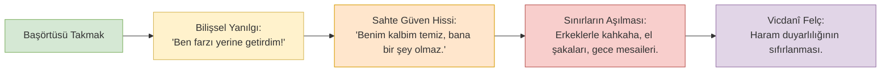

# 03. "Kalkan"dan "Kimlik Kartına" Dönüşüm ve Sahte Güven

> *"Kişi bir farzı şeklen yerine getirdiğinde, o farzın asıl gayesi olan takvayı unutursa; şekil bir ibadet değil, bir aldanış tuzağı haline gelir."*

---

## 1. Giriş: Bir Sembolün Ontolojik İflası

Tesettür, semavi vahyin lügatinde **görünürlüğü sınırlandırmak, nazarları defetmek, bedeni meta olmaktan kurtarmak ve haram temasa karşı aşılmaz bir set çekmek** için emredilmiştir. Bu yönüyle tesettür bir **"kalkan"dır (shield)**. Kalkanın varlık sebebi, taşıyıcısını tehlikeden saklamak ve onu görünmez kılmaktır.

Ne var ki son çeyrek asırda yaşanan sosyo-kültürel mutasyon neticesinde başörtüsü; fıkhî koruyucu bir kalkan olma hüviyetini kaybetmiş, kamusal alanda taşınan bir **"ideolojik kimlik kartı"na (badge / token of identity)** evrilmiştir.

Bu ontolojik kaymanın doğurduğu trajedi şudur:
- **Kalkan Taşıyan:** Tehlikeli bölgeden, namahremin nazarlarından ve karma mecralardan ürker, geri çekilir ve kendini korur.
- **Kimlik Kartı Taşıyan:** *"Bakın ben bu kimliğimle, bu rozetimle buradayım; beni kabul etmek zorundasınız!"* diyerek kendini en fıtratsız karma mekânların, açık ofislerin ve alkollü kutlamaların göbeğine pervasızca atar.

Başörtüsü artık kişiyi haramdan koruyan bir zırh değil; seküler karma sistemin kapılarından içeri süzülmeyi sağlayan bir **"meşruiyet pasaportu"** haline getirilmiştir.

---

## 2. Pierre Bourdieu Sosyolojisi: "Kültürel Sermaye" ve Başörtüsünün Habitus Değişimi

Fransız sosyolog **Pierre Bourdieu (1930–2002)**, *La Distinction* ve *La Domination Masculine* adlı eserlerinde; sembollerin toplumsal sınıflar arasında nasıl birer "sermaye" (capital) ve "tahakküm aracı" olarak el değiştirdiğini çözümler:

### 1. Sembolün Mübadele Değerine (Exchange-Value) Dönüşmesi:
Geleneksel Müslüman kadının örtüsü, piyasa değerinin bütünüyle dışındaydı; Allah ile kul arasındaki mahrem bir itaatti. Neo-liberal kapitalizm ise başörtüsünü piyasaya sürülebilir bir **"sembolik sermaye"** haline getirdi. 
- Muhafazakâr kadın, örtüsünü seküler kurumlar nezdinde *"Bakın ben hem dindarım hem de modern küresel şirketin en başarılı yöneticisiyim"* diyerek bir kariyer kozuna dönüştürdü.
- Şirketler ise başörtülü personeli; kurumsal web sitelerinde, ESG (Environmental, Social, Governance) raporlarında ve reklamlarında **"kültürel çeşitlilik (diversity) vitrini"** olarak sergilemeye başladı.

### 2. Habitusun Dönüşümü:
Bourdieu'nün tabiriyle **habitus** (bireyin içinde yetiştiği değerlerin bedensel ve zihinsel reflekslere dönüşmesi); geleneksel İslam terbiyesinde hayâ, sükûnet, başı öne eğme ve yabancı erkekten fıtrî olarak kaçınma üzerine kuruluydu. 
Modern eğitim ve plaza hayatı, bu habitusu yerle bir etti. Yerine agresif, kendini pazarlayan (self-marketing), networking kovalayan, erkek meslektaşlarıyla laubalice şakalaşabilen seküler bir **kurumsal habitus** ikame edildi. Başörtüsü ise bu seküler habitusun üzerine sadece estetik bir yama olarak iliştirildi.

---

## 3. Jean Baudrillard ve Simülasyon Teorisi: "Gösterge Değeri" Olarak Örtü

Postmodern filozof **Jean Baudrillard (1929–2007)**, *Simulacres et Simulation* adlı eserinde modern nesnelerin gerçeklikle bağını koparıp birer "simülasyona" dönüştüğünü ifade eder:

> *"Bir gösterge, arkasındaki hakikati temsil etmeyi bırakıp, tam aksine o hakikatin yokluğunu gizlemeye başladığında simülakr haline gelir."*

Modern başörtüsü tam olarak bir Baudrillard simülakrıdır:
- Hakiki tesettürün mânâsı; **nazardan sakınmak, vakar ve inzivadır.**
- Modern muhafazakâr modanın sunduğu başörtüsü ise; **aşırı görünürlük (hyper-visibility), parlak renkler, makyaj, lüks marka logoları ve Instagram teşhiridir.**

Burada başörtüsü, tesettürün hakikatini temsil etmez; bilakis tesettürün ve hayânın artık o bedende **mevcut olmadığını gizleyen** sahte bir göstergedir.

---

## 4. Byung-Chul Han ve "Şeffaflık Toplumu"nun Mahremiyet İntiharı

Çağdaş düşünür **Byung-Chul Han**, *Transparenzgesellschaft* (Şeffaflık Toplumu) ve *Agonie des Eros* (Eros'un Istırabı) kitaplarında modernitenin mahremiyeti nasıl yok ettiğini şöyle ortaya koyar:

> *"Şeffaflık toplumu, her şeyin sergilenmesini, pornografik bir açıklıkla teşhir edilmesini ve ekonomik dolaşıma sokulmasını talep eder. Mesafe, gizem ve kapalılık modern sistem tarafından 'özgürlük karşıtı' ilan edilir. Oysa hakiki saygı ve edep, araya mesafe (distans) koyabilmektir."*

İslam fıkhının tesettür anlayışı, Byung-Chul Han'ın tarif ettiği o kutsal **"mesafe"yi (hicâb)** emreder. 
Oysa modern plaza kültürü ve sosyal medya; başörtülü kadına *"Kendini saklama, açıl, konuş, video çek, networking yap, her şeyini sergile"* telkininde bulunmaktadır. Kadın şeffaflaştıkça kutsiyetini, kalkanını ve kalbî derinliğini kaybetmektedir.

---

## 5. Vicdanî Narkoz: "Başım Kapalı, O Halde Güvendeyim" Yanılgısı

Başörtüsünün bir kimlik rozetine indirgenmesi, inançlı bireyde dehşet verici bir **psikolojik uyuşma (vicdanî narkoz)** üretir:

### Bu Narkozun Pratik Tezahürleri:
1. **"Benim Niyetim İyi" Aldatmacası:** Kişi, başörtüsü sayesinde Allah'ın tüm rızasını kazandığını varsayar. Bu yüzden erkek meslektaşlarıyla sınır tanımayan sohbetlere girerken vicdanında en ufak bir sızı duymaz.
2. **Kâsiyâtün Âriyât Uyarısı:** Fahr-i Kâinât Efendimiz (s.a.v.)'in şu mucizevi hadis-i şerifi tam bu zümreyi tasvir eder:
   > *"Ateş ehlinden iki sınıf vardır ki henüz onları görmedim: ... Biri de giyinik oldukları halde çıplak olan (kâsiyâtün âriyât), erkekleri kendilerine meyleden ve kendileri de onlara meyleden kadınlardır..."* **(Müslim, Libâs 125)**
   İmam Nevevî ve İbn Abdilberr bu hadisi şerhederken: *"Bedeni kumaşla örtülü olsa bile; dar, şeffaf, dikkat çekici giyinen ve tavırlarıyla erkekleri cezbeden kimseler hakikatte çıplaktırlar"* derler.

---

## 6. Kalkan ile Kimlik Kartının Derin Karşılaştırması

| Kriter | Fıkhî "Kalkan" (Hakiki Tesettür) | Modern "Kimlik Kartı" (Şekli Örtü) |
| :--- | :--- | :--- |
| **Temel Felsefe** | Mahviyet, hayâ, görünmezlik, takva. | Görünürlük, benlik, kariyer, tanınma. |
| **Mekânsal Tavır** | Erkeklerle dolu karma ortamlardan kaçınır. | Karma amfilere ve ofislere zafer edasıyla girer. |
| **İletişim Tonu** | Ahzâb 32 gereği: Ciddi, mesafeli, resmi, soğuk. | "Kanka" muhabbeti, kahkahalar, emojili DM'ler. |
| **Zihinsel Hal** | Teyakkuz hali; her an günahtan ürperme. | Sahte vicdani rahatlık; "Ben kapalıyım, sorun yok." |
| **Sosyolojik Konum** | Sistemin tüketim çarkına radikal itiraz. | Sistemin "diversity" vitrininde uyumlu aktör. |
| **Ahiret Akıbeti** | Cenab-ı Hakk'ın rızası ve cennet müjdesi. | "Kâsiyâtün âriyât" tehdidi ve manevi hüsran. |

---

## 7. Netice: Zırhı Yeniden Kuşanmak

Bir kadının başındaki örtü; onu plazanın erkeklerine "şirin, modern ve uyumlu bir iş arkadaşı" yapmak için inmemiştir. O örtü, o kadını fâsık ve gâfil bakışlardan korumak için semadan indirilmiş ilahi bir emirdir.

Kimlik kartı sizi sisteme köle yapar; kalkan ise sizi Allah'a kul kılar.  
Kalkanı elden bırakanlar, kafalarında taşıdıkları bez parçasıyla ancak kendilerini kandırırlar.
