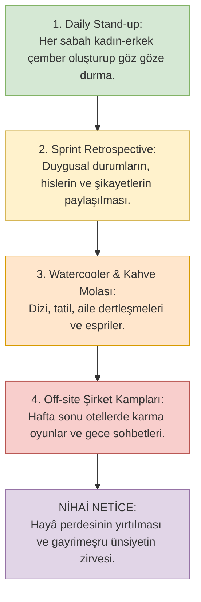

# 04. Plaza Kültürü, Açık Ofisler ve "Profesyonellik" İllüzyonu

> *"Kim bir kavme benzemeye çalışırsa, o da onlardandır."*  
> **(Ebû Dâvûd, Libâs, 4)**

---

## 1. Giriş: Kurumsal Sistemin Seküler İbadethaneleri

Modern kapitalizm, yalnızca malların ve hizmetlerin üretildiği iktisadi bir düzenek değildir; bireylerin dilini, zaman idrakini, beden duruşunu, cinsi kimliğini ve nihayetinde ahlakını baştan aşağı formatlayan **totaliter bir seküler dindir**.

Bu seküler dinin:
- **Katedralleri:** Cam kuleler ve plazalar,
- **İbadetleri:** 9-to-6 mesailer, daily stand-up'lar ve sprint toplantıları,
- **Kutsal Metinleri:** Kurumsal misyon-vizyon bildirgeleri ve İK tüzükleri,
- **Ahlak Yasası ise:** *"Kurumsal Profesyonellik"* (Corporate Professionalism) kavramıdır.

Muhafazakâr birey bu mabede adım attığında dininden vazgeçtiğini zannetmez; lakin sistem öyle girift, baştan çıkarıcı ve incelikli bir habitus inşa etmiştir ki, birkaç yıl içinde İslam fıkhının tavizsiz mahremiyet hudutları, yerini küresel şirketin konformist ahlakına terk eder.

---

## 2. Açık Ofis Mimarisi: Foucault, Panoptikon ve Mahremiyetin İmhası

Geleneksel İslâm şehir ve konut mimarisinde mekân; insan fıtratını ve aile mahremiyetini korumak maksadıyla **iç içe geçmiş halkalar halinde** kademelendirilirdi (sokak, avlu, selamlık, haremlik). Yabancı bir gözün aile mahremiyetine veya kadınların bulunduğu alana izinsiz sızması fıkhen en ağır cürümlerden sayılırdı.

Modern plaza mimarisi ise bu fıtrî düzeni kökten imha ederek **Açık Ofis (Open-Plan Office)** modelini küresel standart kıldı.

### Michel Foucault ve "Panoptikon" Çözümlemesi:
Fransız düşünür **Michel Foucault (1926–1984)**, *Surveiller et Punir* (Hapishanenin Doğuşu) eserinde Jeremy Bentham'ın tasarladığı "Panoptikon" mimarisini modern kurumların temel disiplin aygıtı olarak tahlil eder:

> *"Panoptikon'un temel prensibi; herkesin herkes tarafından her an görülebilir olmasıdır. Duvarların kalkması, bireye özgürlük getirmez; bilakis bireyi sürekli bir gözetim, denetim ve tek tipleşme cendresine sokar. Görünür olan beden, disipline edilmiş ve itaatkâr kılınmış bedendir."*

Açık ofis, modern plazaların panoptikonudur:
- Bütün duvarlar, paravanlar ve kapılar kaldırılmıştır.
- Kadın ve erkek çalışanlar, aralarında 40-50 santimetrelik mesafelerle, uzun masalarda yüz yüze veya yan yana oturtulur.
- Gün boyu namahrem bir erkeğin nefesini, kokusunu, ses tonunu, mimiklerini, ekrandaki yazışmalarını ve beden hareketlerini algılayacak bir fiziki yakınlık dayatılır.
- **Fıkhî Hüküm:** İmam Serahsî (v. 483/1090) *el-Mebsût* adlı eserinde, bir mekânın meşruiyetini mahremiyetin teminine bağlar. Yabancı kadının ve erkeğin gün boyu birbirinin bakış menzilinde kalmaya zorlandığı açık ofis mimarisi, Nûr Sûresi 30-31'deki *gadd-ı basar* (bakışı sakınma) farzını pratikte imkânsız kılar. İmkânsız olan farz terkedilir; terkedilen farz ise mekânı günah havuzuna çevirir.

---

## 3. "Profesyonellik" (Corporate Professionalism) Bir Ahlak mıdır, Maske mi?

Plaza ekosisteminin en tehlikeli felsefi illüzyonu "profesyonellik" argümanıdır. Bu zihniyet şu sahte aksiyomları vazeder:
1. *"Biz burada kadın ve erkek değiliz; hepimiz unvan sahibi profesyonelleriz."*
2. *"Burada cinsiyet konuşmaz, iş hedefleri (KPI / OKR) konuşur."*
3. *"Herkes işine odaklanmıştır; kimse ark niyet taşımaz."*

### Fıkhî ve Psiko-Sosyolojik Reddiye:

#### 1. Fıtrat Ceket Giymez:
Bir insanın üzerine takım elbise giydirip eline plazanın manyetik giriş kartını vermek; Allah Teâlâ'nın onun içine koyduğu şehevî çekimi, cinsi fıtratı ve zaafları ortadan kaldırmaz. Kâsânî (v. 587/1191) *Bedâi'u's-Sanâi'*de der ki:  
> *"Şeriatın hükümleri insanların kuru iddialarına ve hüsn-i zanlarına değil; beşer tabiatının değişmez zaaflarına (fıtrata) göre inşa edilir. Şehvet potansiyeli taşıyan her karşılaşma, mefsedet doğurmaya adaydır."*

#### 2. Kelimelerin İllüzyonu:
Kapitalist plaza jargonu, fıkhî haramların üzerini modern kelimelerle örter:
- İki kişinin baş başa kalıp kapıyı kapatması fıkhen **Halvet** iken, plazada adı **"1-on-1 Feedback Session"** veya **"Mentorluk"** olur.
- Karşı cinsle laubalice şakalaşmak fıkhen **Ahzâb 32 İhlali** iken, plazada adı **"Ice-breaking"** veya **"Ekip Sinerjisi"** olur.
- Alkol tüketilen şirketin karma gece eğlenceleri fıkhen **Fısk ve Teşebbüh** iken, plazada adı **"After-work Party"** veya **"Happy Hour"** olur.

Kelimelerin değişmesi, fiilin şer'î mahiyetini ve günah yükünü zerre kadar değiştirmez!

---

## 4. Modern Agile Rutinleri ve Gayriresmî Ünsiyet Alanları

Bugün özellikle yazılım ve teknoloji şirketlerinde uygulanan çevik yönetim (Agile/Scrum) pratikleri, farkında olunmadan şer'î sınırların en hızlı eridiği temas alanlarına dönüşmüştür:

### David Graeber ve "Bullshit Jobs" Açısından Değerlendirme:
Antropolog **David Graeber (1961–2020)**, *Bullshit Jobs* kitabında plazalardaki pek çok pozisyonun gerçekte bir değer üretmediğini, personelin sadece "çalışıyor görünmek ve sosyalleşmek" için saatler harcadığını ispatlar.  
Gerçek bir iş üretilmeyen bu boş zamanlar (idle time); kahve makineleri başında laubali muhabbetlere, karşı cinse kur yapmaya ve İmam Gazâlî'nin uyardığı ünsiyet bataklığına zemin hazırlar.

---

## 5. "Diversity & Inclusion" (Kapsayıcılık) Kapitalizmin Truva Atıdır

Çokuluslu şirketlerin "Çeşitlilik, Eşitlik ve Kapsayıcılık" (DEI) programları, muhafazakâr kitlelere bir "inanç özgürlüğü zaferi" gibi yutturulmaktadır:
> *"Bakın şirketimizde başörtülü yazılımcılar da var, hatta mescid bile açtılar!"*

Oysa **Shoshana Zuboff**'un *The Age of Surveillance Capitalism* (Gözetleme Kapitalizmi Çağı) eserinde vurguladığı üzere; küresel sermaye, sisteme meydan okuma potansiyeli taşıyan her radikal değeri **metalaştırarak ehlileştirir.**

Kapitalist şirket Müslümana şunu söyler:
> *"Başörtünü takabilirsin, mescitte 10 dakika namazını da kılabilirsin. Biz buna izin veririz; çünkü bu bize kurumsal 'hoşgörü' PR'ı kazandırır. Yeter ki sen geri kalan 9 saat boyunca bizim karma açık ofisimizde otur, namahrem erkeklerle omuz omuza çalış, şirket hedeflerimiz için ruhunu sat ve sistemin fıtratsızlığına asla itiraz etme!"*

Bu takas, İslam'ın iffet ve izzetini şirket bordrosuna satmaktır.

---

## 6. Fıkhî Hüküm ve Çıkış Yolu

İslam fıkhı, inançlı bir ferdin (kadın veya erkek) kalbini, hayâsını ve ahiretini tehlikeye atan böylesi bir ekosistemde çalışmasını **caiz görmez.**

Alternatif nedir?
1. **İstifa ve Rızkı Allah'tan Bilme:** Cenâb-ı Hak buyurur: *"Kim Allah'tan korkarsa, Allah ona bir çıkış yolu ihsan eder ve onu ummadığı yerden rızıklandırır."* (Talâk, 2-3).
2. **Remote (Uzaktan) ve Asenkron Çalışma:** Fiziksel açık ofislerden uzak durup, şer'î iletişim disiplinine riayet ederek evden üretim yapmak.
3. **Müstakil Girişimler:** Müslüman kadınların bir araya gelerek kendi yazılım ajanslarını, kendi Ar-Ge merkezlerini kurmaları; erkeklerin de kendi alanlarında bağımsız İslami iş modelleri inşa etmeleri.
