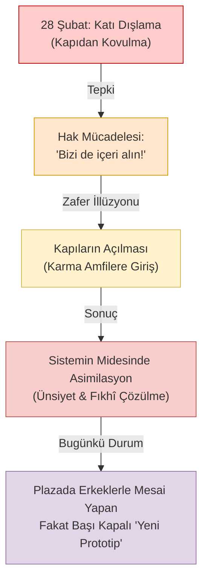

# 06. 28 Şubat ve Asimile Olma Yanılgısı: Kapıda Beklemekten Masaya Oturmaya

> *"Asıl yenilgi, inançlı bir kadının o karma sistemin kapısından çevrilmesi değil; o kapıdan güle oynaya içeri alınıp, sistemin midesinde ruhunu kaybederek sindirilmesidir."*

---

## 1. Giriş: Bir Direnişin Anatomisi ve Sapması

Türkiye'nin yakın siyasi ve sosyolojik tarihinde **28 Şubat süreci**, başörtülü kadınların üniversite kapılarından polis zoruyla geri çevrildiği, ikna odalarında psikolojik işkencelere maruz bırakıldığı karanlık bir dönem olarak kayıtlara geçmiştir.

O günlerde verilen mücadele son derece samimi, fedakâr ve haklı bir çığlıktı. Ancak aradan geçen çeyrek asrın ardından geriye dönüp soğukkanlı bir fıkhi ve sosyolojik muhasebe yapıldığında, o mücadelenin **derin bir stratejik ve felsefi körlükle malul olduğu** açıkça görülmektedir.

Müslüman zihin, o dönemde şu hayatî soruyu sormayı akıl edememiştir:
> *"Biz bu kapının önünde ne için bekliyoruz? İçerideki sistem İslami, fıtrî ve meşru bir sistem midir ki biz oraya girmek için ömrümüzü ve izzetimizi tüketiyoruz?"*

---

## 2. Sistemin Kendisine Değil, Dışlama Biçimine İsyan Etmek

28 Şubat direnişinin temel zaafı; **seküler, pozitivist ve karma eğitim sisteminin bizzat kendisine bir itiraz geliştirememiş olmasıdır.**

- İtiraz, amfilerde kız ve erkek öğrencilerin dirsek dirseğe, fıtrata aykırı bir ihtilat içinde okutulmasına değildi.
- İtiraz, müfredatın materyalist ve seküler felsefesine değildi.
- İtiraz, yalnızca *"Bizi de bu karma sistemin içine başörtümüzle alın"* feryadından ibaretti.

Müslümanlar sistemin mimarisini sorgulamadılar; sistemin kapısındaki bekçiye itiraz ettiler. Bekçi değişip kapılar ardına kadar açıldığında ise büyük bir zafer kazanıldığını zannettiler. Oysa sistem, başörtüsünü içeri alarak onu yok etmenin en konforlu yolunu bulmuştu: **Sindirerek asimile etmek.**

---

## 3. "İkna Odaları"ndan "Plaza Toplantı Odaları"na

28 Şubat'ın simgesi haline gelen **"İkna Odaları"nda** rektör yardımcıları ve bürokratlar genç kızları zorla başlarını açmaya ikna etmeye çalışıyor, bunu başaramayınca onları sistemden kovuyorlardı. Düşman açıktı, cephe belirgindi, teyakkuz tamdı.

Bugün ise çok daha sinsi, güler yüzlü ve tatlı bir ikna süreci işletilmektedir:
- Artık kimse başörtünü çıkar demiyor.
- Aksine, *"Başörtünle çok şıksın, sen modern Türk kadınının gururusun, gel şu uluslararası karma projenin başına geç"* deniyor.
- İkna odalarının yerini cam kulelerdeki **"Plaza Toplantı Odaları"** almıştır.
- Dün zorla başı açılamayan kadınların torunları ve çocukları; bugün o toplantı odalarında erkek meslektaşlarıyla gece yarılarına kadar kahkahalar atarak, fıkhî mahremiyet sınırlarını bizzat kendi elleriyle çöpe atmaktadırlar.

Baskı ve zulümle alınamayan kale; konfor, kariyer ve "kabul görme" rüşvetiyle içeriden fethedilmiştir.

---

## 4. Alternatif İnşa Edememenin Entelektüel İflası

Bir medeniyet iddiası taşıyan inanç topluluğu, karşılaştığı krizlere iki türlü cevap verir:
1. **Asimilasyoncu Entegrasyon:** Mevcut hâkim paradigmanın içine monte olmaya çalışmak, onun şartlarına boyun eğip kenarına ilişilmek.
2. **Özgün ve Kurucu İnşa:** Kendi dünya görüşüne, fıkhına ve fıtratına uygun bağımsız kurumlar, üniversiteler, laboratuvarlar ve üretim havzaları kurmak.

Ne yazık ki son 20 yılda muhafazakâr sermaye ve akıl, bütün imkânlara sahip olmasına rağmen kadın ve erkeğin fıtrî sınırlarla eğitim gördüğü tek bir saygın tıp fakültesi, tek bir küresel mühendislik enstitüsü, tek bir alternatif kurumsal ekosistem inşa edememiştir. Bütün enerji, çocukları seküler karma kolejlere ve Boğaziçi/ODTÜ türevi kurumlara sokma yarışına harcanmıştır.

Bu durum, fıkhî teslimiyetin değil, zihinsel sömürgeleşmenin ve aşağılık kompleksinin apaçık bir vesikasıdır.

---

## 5. Tezatlar Diyagramı: Mücadele Nerede Başladı, Nereye Evrildi?

---

## 6. Tarihi İtiraf ve Gelecek Çağrısı

Geriye dönüp baktığımızda görülüyor ki; 28 Şubatçılar inançlı insanları amfilerden kovarken, istemeden de olsa onların fıkhî mahremiyetini ve şer'î izzetini koruyorlardı. Çünkü o amfi zaten bir Müslümanın bulunmaması gereken fıtratsız bir ihtilat bataklığıydı.

Bugünün görevi, geçmişin yanılgılarıyla yüzleşmektir:
- Karma sistemlerin içine sızmak bir muvaffakiyet değil, bir hezimettir.
- Gerçek başarı; kadının kadınla, erkeğin erkekle ilim ve teknoloji ürettiği, mahremiyetin baş tacı edildiği **bağımsız İslami alternatifleri sıfırdan inşa etme cesaretini göstermektir.**
