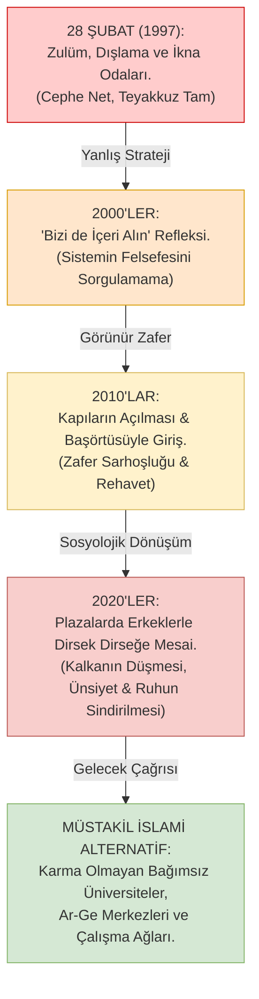

# 06. 28 Şubat ve Asimile Olma Yanılgısı: Kapıda Beklemekten Masaya Oturmaya

> *"Asıl yenilgi, inançlı bir kadının o karma sistemin kapısından çevrilmesi değil; o kapıdan güle oynaya içeri alınıp, sistemin midesinde ruhunu kaybederek sindirilmesidir."*

---

## 1. Giriş: Bir Direnişin Anatomisi, Zaferi ve Felsefi İflası

Türkiye'nin yakın siyasi ve sosyolojik tarihinde **28 Şubat 1997 süreci**, inançlı kesim üzerinde estirilen devlet terörünün, üniversite kapılarından başörtülü genç kızların polis zoruyla atılmasının, ikna odalarında yapılan psikolojik baskıların ve tasfiyelerin adıdır.

O günlerde kampüs kapılarında, Beyazıt Meydanı'nda verilen mücadele; safiyeti, fedakârlığı ve azmi bakımından tarihe geçmiş şanlı bir direniştir. Ancak aradan geçen çeyrek asırlık zaman diliminin ardından; olayların tozu dumanı dağıldığında ve ortaya çıkan bugünkü manzara soğukkanlı bir fıkhî-sosyolojik neşterle incelendiğinde; o mücadelenin **büyük bir stratejik yanılgıyla ve felsefi basiretsizlikle malul olduğu** gün gibi aşikârdır.

Müslüman zihin, o günlerde kapının önünde direnirken şu en temel ontolojik soruyu sormayı akıl edememiştir:
> *"Biz bu kapının önünde ne için bekliyoruz? Arkasında durduğumuz o üniversite, o amfi, o sistem; İslam'ın meşru gördüğü, fıtrata uygun, Müslümanca bir ilim yuvası mıdır ki biz oraya girmek için ömrümüzü ve izzetimizi tüketiyoruz?"*

---

## 2. Sistemin Kendisine Değil, Dışlama Biçimine İtiraz Etmek

28 Şubat direnişinin temel felsefi kusuru; **seküler, materyalist ve pozitivist karma eğitim paradigmasının bizzat kendisine hiçbir köklü itiraz geliştirememiş olmasıdır.**

- **Neye İtiraz Edilmedi?**
  - Kız ve erkeklerin aynı sıralarda dirsek dirseğe, fıtrata aykırı bir ihtilat içinde okutulmasına itiraz edilmedi.
  - Batı menşeli, pozitivist, ilahi vahyi inkâr eden müfredata itiraz edilmedi.
  - Amfilerin kadını nesneleştiren, erkeğin gözünü disiplinsizleştiren yapısına itiraz edilmedi.
- **Neye İtiraz Edildi?**
  - İtiraz yalnızca ve yalnızca sistemin **dışlama biçimineydi.**
  - Tek talep şuydu: *"Ne olur bizi de bu karma sistemin içine, bu amfilerin sıralarına başörtümüzle kabul edin!"*

Müslümanlar sistemin mimarisini, felsefesini ve ahlakını sorgulamadılar; yalnızca kapıdaki üniformalı bekçinin sertliğine isyan ettiler. Bekçi değişip kapılar ardına kadar açıldığında ise büyük bir fethin gerçekleştiğini zannettiler.

Oysa sistem, başörtüsünü içeri alarak onu yok etmenin en konforlu ve en kalıcı yolunu bulmuştu: **Sindirerek asimile etmek.**

---

## 3. Frantz Fanon ve Sömürge Psikolojisi: "Beyaz Maskeli Siyah Derililer"

Cezayir bağımsızlık mücadelesinin büyük düşünürü **Frantz Fanon (1925–1961)**, *Peau noire, masques blancs* (Siyah Deri, Beyaz Maskeler) kitabında sömürgeleşmiş bilincin psikolojisini şöyle teşrih eder:

> *"Sömürgeleştirilmiş insanın en büyük trajedisi; sömürgecisini alt etmek değil, sömürgecisi tarafından 'onaylanmak' ve onun kurumlarına kabul edilmektir. O, efendisinin masasında kendine bir sandalye bulduğunda özgürleştiğini sanır; oysa tam o anda zihnen bütünüyle teslim olmuştur."*

28 Şubat sonrası muhafazakâr aklın durumu tam olarak Fanon'un tarif ettiği bu sömürge psikolojisidir:
- Yıllarca "seküler beyaz Türkler" tarafından gerici, köylü, eğitimsiz görülerek dışlanmış bir kitle; çocuklarını Boğaziçi'ne, ODTÜ'ye, Robert Kolej'e sokabildiğinde ve o karma ortamlarda başörtülü kızları derece yaptığında kendini "ispatlamış" hissetti.
- Bu bir aşağılık kompleksinin (inferiority complex) ürünüydü. 
- İspat arayışı; İslam'ın fıkhî mahremiyet ölçülerini, haremlik-selamlık şuurunu ve vakarını haraç mezat feda etme pahasına yürütüldü.

---

## 4. Aliya İzzetbegoviç ve İsmet Özel: Sahte Kurtuluşun İflası

### Aliya İzzetbegoviç (v. 2003) *Doğu ve Batı Arasında İslam*:
> *"İslam, modern Batı uygarlığının içine iliştirilecek bir 'aksesuar' veya 'folklorik motif' değildir. İslam; insanı, toplumu ve mekânı baştan aşağı kuran müstakil bir medeniyet nizamıdır. Eğer siz Batı'nın kurumlarını olduğu gibi alıp içine sadece başörtüsü veya namazı yerleştirmeye çalışırsanız, elde edeceğiniz şey bir sentez değil, bir canavardır."*

### İsmet Özel *Üç Mesele: Fikir, Amel, İbadet*:
> *"Türkiye'de Müslümanlar, modern hayatın getirdiği kurumlara intibak etmeyi (uyum sağlamayı) Müslümanlığın başarısı sandılar. 'Biz de onlar gibi fabrika sahibi olabiliriz, biz de onlar gibi plazalarda oturabiliriz, biz de üniversitede kürsü kapabiliriz' dediler. Fakat sormadılar: Fabrikanın, plazanın ve üniversitenin mantığı İslam'a uygun mudur? Uygun olmadığını anladıklarında ise artık çok geçti; çünkü bizzat kendileri o mantığın kulu haline gelmişlerdi."*

---

## 5. İkna Odalarından Plaza Masalarına: Ne Değişti?

28 Şubat'ın simgesi haline gelen **"İkna Odaları"nda** rektör yardımcıları ve bürokratlar genç kızları zorla başlarını açmaya ikna etmeye çalışıyor, direnenleri okuldan atıyorlardı. O gün düşman açıktı, sınır netti, müminlerin basireti ve teyakkuzu en üst düzeydeydi.

Bugün ise çok daha sinsi, tebessüm eden ve lüks ambalajlı bir ikna süreci yürütülmektedir:
- Artık kimse başörtünü çıkar demiyor.
- Bilakis: *"Başörtünle çok şıksın, şirketimizin çeşitlilik gururusun, gel şu uluslararası karma projenin başına geç"* deniyor.
- İkna odalarının yerini cam kulelerdeki **"Executive Board Room"lar** almıştır.
- Dün zorbalıkla başından örtüsü çekilemeyen kadınların evlatları; bugün o toplantı odalarında erkek meslektaşlarıyla gece yarılarına kadar kahkahalar atarak, aradaki fıtrî ve fıkhî hicâbı bizzat kendi elleriyle çöpe atmaktadırlar.

Baskı ve zulümle düşürülemeyen kale; konfor, kariyer ve "onaylanma" rüşvetiyle içeriden fethedilmiştir.

---

## 6. Tarihi Diyagram: Zafer Zannedilen Asimilasyon Süreci

---

## 7. Tarihi İtiraf ve Gelecek Çağrısı

Geriye dönüp baktığımızda görülüyor ki; 28 Şubatçılar inançlı insanları amfilerden kovarken, aslında onların fıkhî mahremiyetini ve şer'î izzetini koruyorlardı. Çünkü o amfi zaten bir Müslümanın bulunmaması gereken fıtratsız bir ihtilat bataklığıydı.

Bugünün vazifesi, geçmişin stratejik körlüğüyle yüzleşmektir:
- Seküler karma kurumların midesine girmek zafer değil, hezimettir.
- Gerçek başarı; kadının kadınla, erkeğin erkekle ilim, yazılım ve teknoloji ürettiği; mahremiyetin baş tacı edildiği **bağımsız İslami alternatifleri sıfırdan kurma izzetini kuşanmaktır.**
