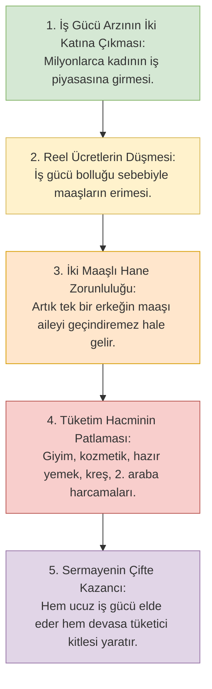

# 09. Kapitalizm, Kadın Emeği ve Ailenin Tasfiyesi: Özgürleşme Yalanı

> *"Evlerinizde vakarla oturun; önceki cahiliye kadınlarının açılıp saçılması gibi açılıp saçılmayın..."*  
> **(el-Ahzâb Sûresi, 33)**

---

## 1. Giriş: Kapitalizmin En Büyük Başarısı: Kadını Aileden Koparmak

20. yüzyılın ortalarından itibaren küresel sermaye, modern kadına tarihin en büyük ve en aldatıcı vaadini sundu: **"Ekonomik Özgürlük ve Kariyer Bağımsızlığı."**

Feminist ideolojiyle el ele veren neo-liberal düzen; kadının evinde eş ve anne olarak üstlendiği fıtrî ve mukaddes vazifeleri "kölelik", "ezilmişlik" ve "gericilik" olarak damgaladı. Kadına tek kurtuluş reçetesi olarak; sabahın köründe kalkıp metrobüslere doluşmayı, plazalarda erkek müdürlerin emri altında saatlerce ter dökmeyi ve bir şirket bordrosuna mahkûm olmayı "özgürlük" diye yutturdu.

Bugün gelinen noktada soğukkanlı bir iktisadî ve sosyolojik bilanço çıkarıldığında görülmektedir ki; kadın özgürleşmemiş, yalnızca **kocasına veya ailesine olan hürmet ve muhabbetini, küresel şirket patronlarına kölelikle takas etmiştir.**

---

## 2. Ekonomi Politiğin Gerçeği: Ucuz İş Gücü ve İki Maaşlı Hane Tuzağı

Kapitalizmin kadını evden çıkarıp karma iş alanlarına sürmesinin arkasındaki gerçek sebep ne hümanizmdir ne de kadın hakları sevdasıdır. Sebep bütünüyle kaba ve acımasız bir **kâr maksimizasyonu hesabıdır**:

### Ivan Illich ve "Gölge İş" (Shadow Work):
Büyük düşünür ve toplum eleştirmeni **Ivan Illich (1926–2002)**, *Gender* ve *Shadow Work* adlı eserlerinde; piyasa ekonomisinin kadınları "özgürleştirme" bahanesiyle piyasanın dişlileri arasına çekerek fıtrî cinsi dengeleri nasıl tahrip ettiğini belgeler. Kadın evdeki egemen ve onurlu konumunu kaybetmiş, şirketlerin standartlaştırılmış bir "üretim birimine" dönüşmüştür.

---

## 3. Demografik Çöküş ve Ailenin Tasfiyesi

Kadının bütün gününü plazada erkek meslektaşlarıyla mesaide tüketmesinin aile üzerindeki faturası tam bir felakettir:

1. **Evliliklerin İntiharı ve Boşanma Patlaması:**  
   Günde 10 saatini ev dışında yabancı erkeklerle geçiren, akşam eve yorgun ve tükenmiş halde dönen kadının eşine muhabbet ve sadakat sunması imkânsızlaşmaktadır. Karşı cinsten meslektaşlarla kurulan "ünsiyet", evdeki meşru nikâh bağını duygusal olarak çürütmekte; boşanma oranları tarihin en yüksek seviyelerine çıkmaktadır.
2. **Demografik Kış (Doğurganlık Oranlarının Çöküşü):**  
   Kariyer hırsı ve plaza mesaisi, annelik fıtratını felç etmiştir. Çocuk doğurmak bir "kariyer engeli" ve "ayak bağı" olarak görülmektedir. Türkiye dahil tüm modern dünyada doğum oranları nüfusun kendini yenileme eşiği olan 2.1'in fersah fersah altına düşmüş (1.5'ler seviyesi); toplum hızla yaşlanan bir demografik kışa sürüklenmiştir.
3. **Çocukların Kreşlere ve Bakıcılara Terk Edilmesi:**  
   Kutsal anne kucağının yerini, 6 aylıkken bırakılan soğuk kreş odaları ve yabancı bakıcılar almıştır. Sevgi ve anne şefkatinden mahrum büyüyen nesiller; psikolojik buhranların, nihilizmin ve ahlaki çözülmenin pençesinde kıvranmaktadır.

---

## 4. Christopher Lasch: "Sığınaksız Dünyada Sığınak Olarak Aile"

Amerikalı sosyolog **Christopher Lasch (1932–1994)**, *Haven in a Heartless World: The Family Besieged* (Acımasız Dünyada Sığınak) eserinde kapitalizmin aileyi nasıl kuşattığını haykırır:

> *"Aile, kapitalist piyasanın acımasız rekabetinden insanın kaçıp sığınabileceği son sevgi, şefkat ve mahremiyet kalesiydi. Piyasa bu kaleyi yıktı. Aileyi şirketin uzantısı haline getirdi. Artık kadın da erkek de şirketin malıdır; ev ise sadece gece uyunan bir otele dönüşmüştür."*

---

## 5. İslâm'ın Asil Sosyal Güvenlik Modeli: Kadının İktisadî Masuniyeti

Modern dünya Müslüman kadına "Eğer çalışmazsan aç kalırsın, koca eline bakarsın" zilletini fısıldarken; İslam fıkhının kadına tanıdığı hakların zerresini bile hayal edemez:

- **Mutlak Nafaka Mükellefiyeti:** İslam hukukunda bir kadının kendisini, çocuğunu veya evi geçindirme gibi bir mecburiyeti **asla yoktur.** 
- Nafaka temini; bekârken **babasının**, evliyken **kocasının**, dul kaldığında **oğlunun veya erkek kardeşlerinin**, kimsesi yoksa **İslam Beytülmâlinin (Devletin)** boynuna farz kılınmıştır.
- **Kadının Malının Dokunulmazlığı:** Kadın çalışıp servet kazansa bile, bu servetten evin geçimine tek bir kuruş harcamak zorunda değildir; malı tamamen kendisine aittir. Koca, kadının parasından tek kuruş talep edemez.

İslam; kadını ekmek kavgası için sokaklara dökülmekten, yabancı erkeklerin kahrını çekmekten muaf tutmuş; ona evinde kraliçeler gibi hürmet ve himaye görme şerefini bahşetmiştir.

Modern muhafazakâr akıl ise, İslam'ın kadına verdiği bu ilahi himaye ve istirahat hakkını çöpe atmış; kadını kapitalizmin plazalarında erkeklerle yarıştıran vahşi bir düzene teslim etmiştir.

---

## 6. Netice

Aileyi yıkan bir sistem, medeniyet kuramaz.  
Kadını fıtratından koparan bir ekonomi, refah getiremez.

Müslüman kadının en büyük zaferi; seküler bir şirkette unvan sahibi olmak değil, **ahiretini kurtaracak salih nesiller yetiştirdiği vakarlı hanesinde ümmetin geleceğini inşa etmektir.**
