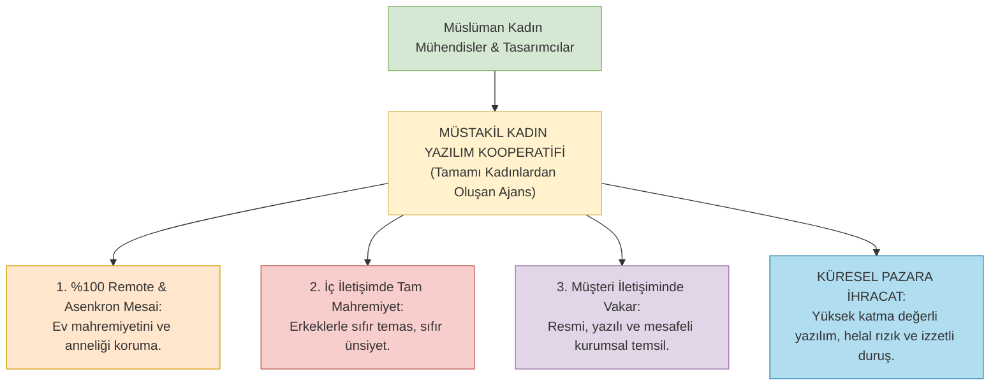

# 11. Müstakil İslâmî Ekosistem ve Çözüm Modeli: "Ne Yapmalı?"

> *"De ki: Hak geldi, bâtıl zâil oldu. Şüphesiz bâtıl, yok olmaya mahkûmdur!"*  
> **(el-İsrâ Sûresi, 81)**

---

## 1. Giriş: Şikâyet Edebiyatından İnşa İradesine

Buraya kadar serdedilen fıkhî, sosyolojik ve psikolojik analizler; meselenin vahametini ve modern karma sistemin Müslüman kimliği nasıl öğüttüğünü apaçık ortaya koymuştur.

Lakin bir Müslüman için hakikati teşhis etmek kafi değildir. İslam, yalnızca kötülüğü nehyeden değil; **marufu emreden ve meşru alternatifi sıfırdan kuran bir inşa dinidir.**

Müslüman gençlerin, mühendislerin, hekimlerin ve sermaye sahiplerinin önünde duran en hayatî soru şudur:
> *"Peki ne yapmalıyız? Karma plazalardan ve seküler kurumlardan el etek çekelim de aç mı kalalım? Dünyadan tamamen tecrit olup mağaralara mı çekilelim?"*

Cevap kat'iyyen bir inziva veya mağaraya çekilme değildir!  
Cevap; **Batı menşeli seküler karma kurumların kopyası olmayan, İslam'ın fıtrat ve mahremiyet nizamını merkezine alan müstakil, izzetli ve küresel ölçekte rekabetçi İslâmî ekosistemleri bizzat inşa etmektir.**

---

## 2. Model 1: Tek Cinsiyetli (Single-Sex) İlim ve Teknoloji Enstitüleri

Modernistlerin *"Ayrı eğitim çağ dışıdır, başarısızlık getirir"* yalanı, bizzat Batı'nın kendi bilimsel verileriyle çürümüştür:

- **Dünyadaki Başarılı Örnekler:**  
  ABD'deki **Wellesley College**, **Smith College**, İngiltere'deki kadın kolejleri veya Japonya'daki kadın üniversiteleri; akademik başarı, liderlik yetiştirme ve bilimsel üretkenlikte karma üniversitelerden çok daha üstün performans sergilemektedir.
- **Odaklanma ve Zihinsel Verimlilik:**  
  Karma amfilerdeki cinsel gerilim, karşı cinse görünme kaygısı ve flört atmosferi zihinsel enerjiyi tüketirken; tek cinsiyetli amfilerde öğrenciler yalnızca ilme, araştırmaya ve teknolojiye odaklanmaktadır.

### Eylem Planı:
Müslüman sermaye sahipleri ve vakıflar; holding binaları dikmek yerine:
1. **Kadınlara Mahsus Tıp ve Sağlık Bilimleri Üniversiteleri,**
2. **Kadınlara Mahsus Yazılım, Yapay Zekâ ve Mühendislik Enstitüleri,**
3. **Erkeklere Mahsus Bağımsız Yüksek Teknoloji Havzaları** kurmakla şer'an mükelleftir.

---

## 3. Model 2: Remote (Uzaktan) ve Asenkron Kadın Yazılım Kooperatifleri

Yazılım, grafik tasarım, veri analizi, yapay zeka modelleme ve dijital pazarlama; fiziksel mekân bağımlılığı en düşük sektörlerdir.

Bu model sayesinde:
- Bir kadın yazılımcı ne açık ofislerin erkek kokan masalarında oturmak zorundadır,
- Ne de gece yarılarında yabancı bir erkek amirle Slack'te laubalileşmek durumundadır.
- Evinde, vakarıyla çalışır; çocuklarını kendi bağrında büyütür ve helal dairesinde yüksek gelir elde eder.

---

## 4. Model 3: Mekânsal Ayrışması Yapılmış (Haremlik-Selamlık) Fizikî Ar-Ge Merkezleri

Mekânsal mevcudiyetin zorunlu olduğu sanayi, donanım, biyoteknoloji ve laboratuvar çalışmalarında ise **fizikî mekân mimarisi** yeniden şer'î esaslara göre tanzim edilmelidir:

- **Bağımsız Kanatlar ve Laboratuvarlar:** Binanın kadın araştırmacılara ait kanadı ile erkek araştırmacılara ait kanadı; bağımsız girişler, bağımsız dinlenme salonları ve laboratuvarlarla tecrit edilir.
- **Dijital Perde Arkası İletişim (Ahzâb 53):** İki birim arasındaki veri ve proje koordinasyonu; yüz yüze ve laubali toplantılarla değil, resmi proje yönetim yazılımları (Jira, GitHub PR) ve şer'î iletişim protokolü üzerinden yürütülür.

---

## 5. Model 4: Helal Risk Sermayesi (Venture Capital) ve Melek Yatırım Ağları

Bugün pek çok inançlı genç girişimci; projesini hayata geçirebilmek için faizli bankalara veya alkollü kokteyllerde networking arayan seküler risk sermayesi fonlarına (VC) el açmak zorunda kalmaktadır.

### Çözüm:
İslâmî sermayedarların bir araya gelerek **"Fıkhî İnovasyon ve Girişim Fonları"** kurması farz-ı kifayedir:
- Yalnızca fıkhî prensiplere (faizsizlik, mahremiyet nizamı, ahlakî ürün) riayet eden projelere tohum ve seri yatırımlar sağlamak.
- Müslüman gençleri seküler melek yatırımcıların kapısında eğilip bükülmekten kurtarmak.

---

## 6. Başarının Yeniden Tanımı: Kariyer Putundan Rıza-i İlahîye

Bütün bu kurumsal adımların atılabilmesi için öncelikle Müslüman zihnin **"başarı"** tanımını baştan aşağı yenilemesi icap eder:

- **Seküler Başarı:** Çok para kazanmak, LinkedIn'de binlerce beğeni almak, çok uluslu şirkette direktör olmak, başkaları tarafından alkışlanmak.
- **İslâmî Başarı (el-Fevzü'l-Azîm):** Allah'ın koyduğu hudutları (hudûdullâh) bir milim dahi aşmamak, nefsine ve çağa mağlup olmamak, arkasında iffetli bir nesil ve helal bir amel defteri bırakarak Cenab-ı Hakk'ın huzuruna ak yüzle çıkabilmektir.

---

## 7. Tarihi Çağrı

Zaman, plazaların cam kulelerinde boynu bükük bekleme zamanı değildir.  
Zaman, başörtüsünü kapitalizmin vitrinine meze etme zamanı hiç değildir.

Zaman; Asr-ı Saadet'in izzetini, Medine'nin vakarını, Endülüs'ün ve Osmanlı'nın kurucu dehasını kuşanarak; **kadının kendi kalesinde azize, erkeğin kendi safında mücahid olduğu yeni bir medeniyet nizamını inşa etme zamanıdır!**
